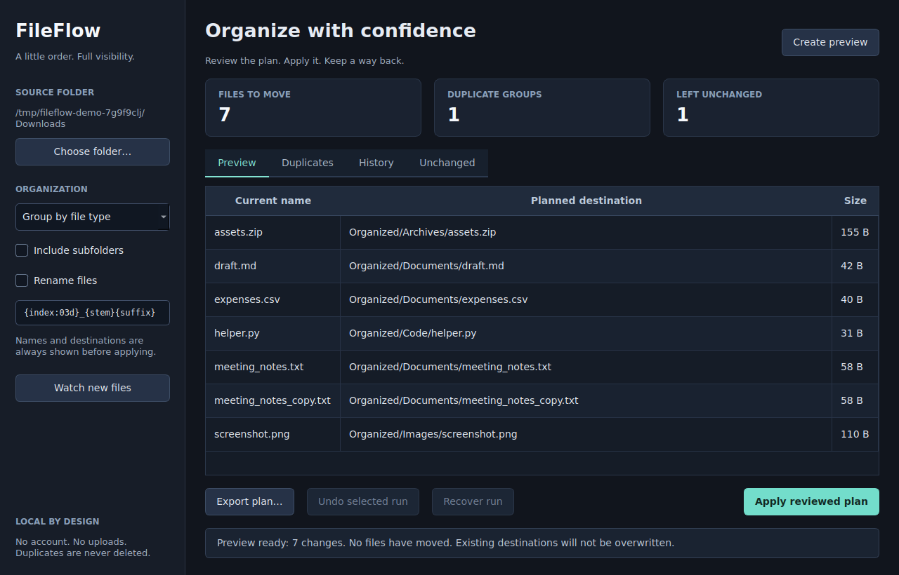
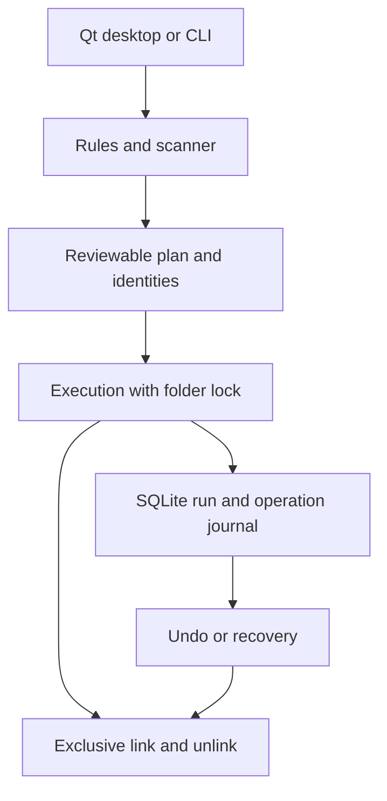

# FileFlow

[](https://github.com/Davorin51/fileflow/actions/workflows/ci.yml)


**A little order. Full visibility.**

A native Python desktop app and CLI for organizing files, reviewing duplicates and reversing
recorded operations. Choose a folder, inspect the exact source/destination plan, then apply.
No accounts, uploads, tracking SDKs or paid APIs.



*Actual Qt widgets rendered in offscreen mode using the included synthetic demo. Counts come
from scanned files. This is not a mockup or proof of testing every desktop environment.*

## What works

| Feature | Behavior |
| --- | --- |
| Organize by type | Configurable extension/category rules; unknown types go to Other |
| Organize by date | UTC file modification year/month; not EXIF capture dates |
| Batch rename | `{stem}`, `{suffix}`, `{index:03d}` and `{date}` templates |
| Collision handling | A numbered alternate name is visible in the preview; execution never overwrites a destination |
| Duplicate review | Size filtering followed by SHA-256 comparison; read-only, no automatic deletion |
| Undo and recovery | SQLite operation history, reverse ordering and explicit recovery of interrupted link/unlink operations |
| Folder watching | Desktop previews new/stable files; CLI can explicitly opt into automatic moves |
| Desktop and CLI | Shared rules, identities and operation engine; desktop hashing/file operations run in a worker |

The CLI core has **no third-party runtime dependencies**. Qt is an optional desktop dependency.

## Install and launch

Requires Python 3.11+. Use a normal local folder on a filesystem supporting hard links, such as
NTFS/ext4/APFS. Cross-filesystem moves and unsupported filesystems fail without removing the
source. Network shares and cloud-synchronized folders are outside the verified scope.

```bash
git clone https://github.com/Davorin51/fileflow.git
cd fileflow
python -m venv .venv
```

**Windows PowerShell**:

```powershell
.\.venv\Scripts\python -m pip install -e ".[desktop]"
.\.venv\Scripts\fileflow-desktop
```

**Linux/macOS shell**:

```bash
source .venv/bin/activate
python -m pip install -e '.[desktop]'
fileflow-desktop
```

You can also run `fileflow gui` or `python -m fileflow gui`. For CLI-only use, install `-e .`
without the desktop extra. No standalone `.exe`, signed installer or macOS app bundle is
claimed in this release. Packaging those is future work.

## Try a disposable demonstration

The demo command creates original sample text/CSV/code, a real PNG and ZIP, one duplicate
pair and an incomplete download. It refuses an existing destination directory.

```bash
fileflow demo demo-downloads
fileflow-desktop demo-downloads
```

For the command line workflow, choose a **new** plan filename:

```bash
fileflow preview demo-downloads --save fileflow-plan.json
fileflow duplicates demo-downloads
fileflow apply fileflow-plan.json --yes
fileflow history demo-downloads
fileflow undo demo-downloads --run latest --yes
```

Preview and duplicate review do not move files or create a journal. A saved plan contains the
reviewed file identities and a checksum. Apply revalidates those identities before moving
anything. A plan checksum detects accidental edits; it is not a signature or authentication
mechanism. Only apply plans you created and reviewed.

After undo, file bytes/names are restored when their identities still match. Empty destination
directories are left in place; FileFlow does not recursively delete directories.

## Configure rules

```bash
fileflow preview demo-downloads --group-by date --save dated-plan.json
fileflow preview demo-downloads --group-by none \
  --rename-template '{index:03d}_{stem}{suffix}' --save rename-plan.json
fileflow preview demo-downloads --config examples/rules.json --save custom-plan.json
```

A config JSON replaces the rule flags rather than silently merging conflicting settings.
See [examples/rules.json](examples/rules.json). Scans are nonrecursive by default; opt into
subfolders with `--recursive`. Hidden files, temporary `.part`/`.tmp`/`.crdownload` files,
symbolic links, FileFlow state and the configured organized destination are excluded or left
unchanged. Unsupported portable filenames are reported rather than rewritten unexpectedly.

## Watch a folder

```bash
fileflow watch demo-downloads --interval 2 --settle 2
# Explicitly opt into automatic organization of new/replaced stable files:
fileflow watch demo-downloads --interval 2 --settle 2 --execute --yes
```

Unchanged files already present at startup are ignored. New/replaced/changed files must keep
their size, modification time and identity stable across the settling period. The watcher
handles new downloads reusing an earlier filename. Stop with Ctrl+C. A quiet period is a
heuristic, not proof that another program has closed a file; identity revalidation still
occurs before execution. Desktop watching always creates previews and still needs Apply.

## Recovery and evidence boundaries

Every intended operation is committed to SQLite before its filesystem action. A move creates
an exclusive hard link at the new name, verifies identity, then removes the old name. A process
interruption may temporarily leave **both names for the same file**. Recovery recognizes that
case using the original inode/device and content hash.

```bash
fileflow history demo-downloads
fileflow recover demo-downloads --run RUN_ID --yes
# Or reverse an applied/partially applied run:
fileflow undo demo-downloads --run RUN_ID --yes
```

A changed file, conflicting old name, unsupported link operation or missing file stops the run
and leaves a recorded error. Undo will not overwrite a new file at an original name. FileFlow
refuses new runs in a folder while an earlier run needs recovery/undo. Keep `.fileflow/` if you
want its history; removing it removes undo information.

**This is not a backup or an atomic multi-file transaction.** Power-loss durability, hostile
concurrent directory replacement and all filesystem/provider behaviors are not guaranteed.
Use folders you control; files are checked repeatedly but these checks are not a security
sandbox. See [the operation contract](docs/safety.md) for exact scope and trade-offs.

## Verification

The authoring run passed **70 tests** with **93.44% coverage of the measured core/CLI modules**.
The Qt desktop module is excluded from that percentage and has four real-widget integration
tests. Tests include actual subprocess exit inside both link/unlink interruption windows,
cross-process lock contention, stale plans, collision injection, symlink boundaries,
read-only duplicates, seeded property tests, watcher behavior and preview → apply → undo.

```bash
python -m pip install -r requirements-dev.lock
python -m pip install --no-deps -e .
python -m ruff check .
python -m ruff format --check .
python -m pytest -q --cov=fileflow --cov-fail-under=90
python -m build
```

For headless Linux, set `QT_QPA_PLATFORM=offscreen` before pytest or screenshot capture. Normal
desktop launches should not set it. GUI tests are skipped if the optional Qt dependency is
missing; CI installs it. Linux machines may need their distribution's EGL/OpenGL libraries.

The [first CI matrix](https://github.com/Davorin51/fileflow/actions/runs/40128654773) passed on Linux/Python 3.11 and 3.12, and Windows/Python 3.12. Read the actual [verification
record](docs/verification.md) and live workflow before assuming a platform passed. macOS
has no completed verification claim. Reproduce the screenshots with
`QT_QPA_PLATFORM=offscreen python scripts/capture_demo.py` on Linux.

## Architecture



- `src/fileflow/models.py`, `planner.py`: configuration, scanning, rename planning, duplicates.
- `safety.py`: portable paths, file identity and exclusive link/unlink.
- `journal.py`: locking, durable operation intentions, run state and reversal.
- `watcher.py`: stable-file detection using an injected monotonic timestamp.
- `cli.py`, `desktop.py`: two interfaces over the same implementation.
- `tests/`: temporary fixtures and real filesystem/Qt integration checks.

See [architecture](docs/architecture.md), [contributing](CONTRIBUTING.md),
[roadmap](ROADMAP.md) and [changelog](CHANGELOG.md).

## License and privacy

Original FileFlow source, fixtures and screenshots are under [MIT](LICENSE). Optional Qt and
development dependencies retain their own licenses and are installed separately, not vendored
in the source archive. No previous employer/university project code or external artwork is used.

All processing is local. Plan/history files contain filenames, paths and hashes; review them
before sharing. There is no telemetry, account database, content upload or duplicate deletion.
